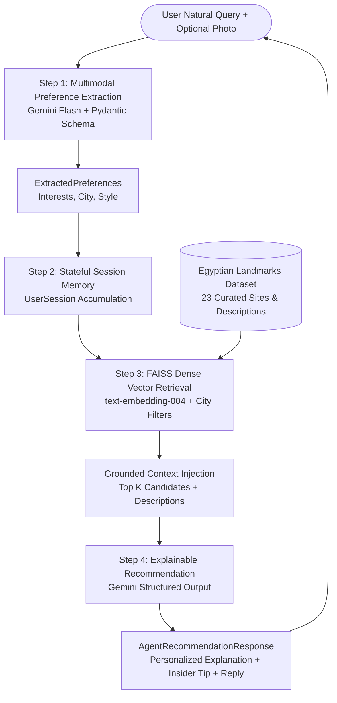

# 🏺 Cleo: Egyptian Tourism Conversational Recommender System (CRS)

An intelligent conversational travel assistant specialized in Egyptian tourism. Cleo takes natural, unstructured tourist queries, extracts fine-grained user preferences into a structured schema (JSON via Pydantic), maintains stateful session memory across dialogue turns, and matches queries against an Egyptian landmarks dataset utilizing rich landmark descriptions for explainable recommendations.

---

## 🏗️ System Architecture



---

## 🚀 Features

1. **Multimodal Preference & Landmark Extraction (LMM)**:
   - Users can provide unstructured natural text **and/or landmark photos** (e.g., coastal fortresses, desert oases, underwater coral reefs).
   - Identifies landmarks from photos, extracts visual aesthetic vibes into `new_interests`, and updates `target_city`.

2. **Stateful Session Memory (`UserSession`)**:
   - Maintains continuous context across multi-turn conversations via `profile` dictionary (`accumulated_interests`, `target_city`, `budget_or_style`).
   - Deduplicates and accumulates interests.
   - Retains city constraints across turns without asking the user to repeat themselves.

3. **Dense Vector Search (FAISS & `text-embedding-004`)**:
   - Replaced keyword passing with an embedding-based similarity index (`faiss.IndexFlatIP`) over landmark descriptions.
   - Combines semantic similarity with regional/city alias routing.

4. **Interactive Split-Screen UI (Streamlit)**:
   - **Left Screen**: Live conversational chat with Cleo and rich landmark cards.
   - **Right Screen**: Real-time `UserSession.to_dict()` JSON inspector, accumulated interest tags, and live RAG similarity scores.

5. **Explainable Recommendations**:
   - Each recommendation includes `why_matched` directly explaining how the landmark's historical/architectural context matches the user's specific extracted preferences.

---

## 📂 Project Structure

```
Project/
├── data/
│   ├── egyptian_landmarks.csv     # 60 curated landmarks across all Egyptian regions with rich descriptions
│   ├── landmark_embeddings.npz    # Cached precomputed dense vector embeddings
│   └── sample_images/             # Reference photos for multimodal testing
├── src/
│   ├── __init__.py                # Package exports
│   ├── schemas.py                 # Pydantic models (ExtractedPreferences, UserSession, MatchedLandmark)
│   ├── vector_store.py            # FAISS dense vector index & embedding engine
│   ├── dataset.py                 # Dataset manager & vector retrieval coordinator
│   ├── agent.py                   # Two-step multimodal LLM extraction and recommendation pipeline
│   └── config.py                  # API key & Gemini client loader
├── tests/
│   └── test_pipeline.py           # Unit and integration test suite
├── main.py                        # Interactive Rich CLI with visual panels & session commands
├── app.py                         # Split-Screen Streamlit Web App (Chat + Real-time UserSession JSON)
├── requirements.txt               # Dependencies (streamlit, google-genai, pydantic, pandas, etc.)
├── .env.example                   # Environment configuration template
└── README.md
```

---

## ⚡ Quick Start

### 1. Launch the Interactive Web App (Recommended)
```powershell
streamlit run app.py
```
Open **`http://localhost:8501`** in your browser.
* **Left Screen**: Conversational chat with Cleo & landmark recommendation cards.
* **Right Screen**: Real-time `UserSession.to_dict()` JSON inspector, accumulated interest tags, and RAG candidate search scores.
* **Sidebar**: API Key settings, model selector, reset button, and 1-click test prompts.

---

### 2. Run the Interactive CLI
```powershell
python main.py
```

### CLI Commands Available During Chat:
- `/profile`: View your accumulated traveler state.
- `/dataset`: Browse the catalog of Egyptian landmarks.
- `/key <api_key>`: Set or update your Gemini API key on the fly.
- `/reset`: Clear the session profile and start fresh.
- `/quit` or `exit`: Exit the assistant.

---

### 3. Run Automated Tests
```powershell
python -m unittest tests/test_pipeline.py
```
